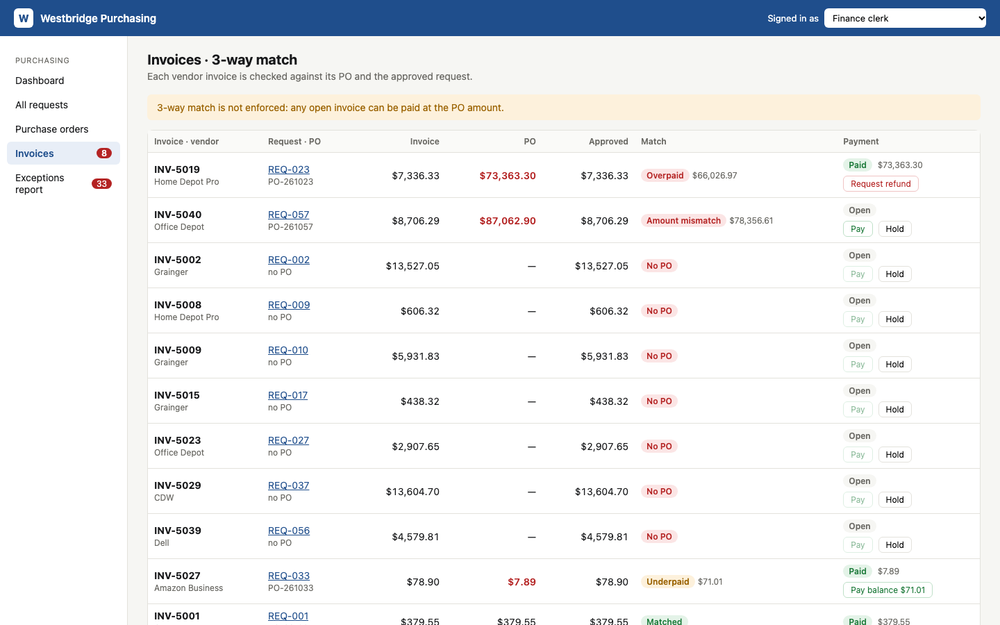

# Westbridge Purchasing (interactive app)

A small mock ERP purchasing module built on the ReqTrace data. It lets you run the **current** process (every control off) and then switch on the **to-be** controls from [`deliverables/03_to_be_process.md`](../deliverables/03_to_be_process.md) and watch the exceptions disappear.

Plain HTML/CSS/JavaScript. No install, no server, no login.

## Run it

Double-click `app/index.html`, or open it in Chrome or Safari. Work is saved in your browser. **Controls & settings → Reset demo data** puts everything back to the start.

To open the app as a specific role (useful for bookmarks):

| Role | Link |
|---|---|
| Facilities requester | `index.html?as=requester:Facilities` |
| Admissions manager | `index.html?as=manager:Admissions` |
| Finance Director | `index.html?as=director:` |
| Finance clerk | `index.html?as=clerk:` |

You can also switch roles any time with **Signed in as** at the top right.

## What each role can do

| Role | Screens | Actions |
|---|---|---|
| Requester (6 departments) | Dashboard, department requests, **New request** | Submit (with validation and a duplicate warning), withdraw |
| Department manager (6) | Dashboard, requests, **Approvals** | Approve, reject with a reason |
| Finance Director | Everything + **Controls & settings** | Approve ≥ $5K, turn controls on and off, reset data |
| Finance clerk | **Purchase orders**, **Invoices**, **Exceptions report** | Create POs, fix PO amounts, add GL codes, pay, hold, request refunds, export CSV |

## The five controls (Controls & settings)

| Control | When ON |
|---|---|
| Amount-based approval routing | ≥ $5,000 goes Manager → Finance Director |
| Require GL code on submission | The form blocks submission without one |
| Duplicate request warning | Same department + item, amount within 10%, last 60 days → warning |
| Auto-create PO on final approval | The PO is generated with the approved amount (no re-typing) |
| 3-way match before payment | Pay is disabled unless invoice = PO = approved amount (±2% / $50) |

## Scenarios to try

1. **Find the overpayment.** As the Finance clerk, open Invoices: INV-5019 was paid **$73,363.30** against a **$7,336.33** invoice. Request a refund.
2. **Stop a bad payment.** INV-5040 (REQ-057) has a PO keyed at 10x. Turn on 3-way match and Pay is blocked. Correct the PO amount on the Purchase orders page, then pay.
3. **Policy bypass.** As the Admissions manager, approve REQ-048 ($5,440.79) with routing off: it's final, with no Director sign-off. Reset, turn routing on, and approve again: it goes to J. Alvarez.
4. **Duplicates.** As Facilities staff, submit "Toner cartridges" for $368.20 with the duplicate warning on.
5. **Missing POs.** On Purchase orders, create POs for the 7 approved requests that never got one. Try it with auto-PO off (you type the amount) and with it on.
6. **Clean the books.** Fix GL codes, pay the underpaid balance, and watch the Exceptions report count drop from 33.

## Files

| File | Purpose |
|---|---|
| `index.html`, `styles.css`, `app.js` | The app |
| `data.js` | Seed data, generated by `src/build_app_data.py` from the CSVs in `data/` |
| `screenshots/` | Screens at 1440×900 |

Vendor invoices are simulated: each vendor bills the approved amount, and a PO that was already paid was paid at the amount finance typed into the PO log.
