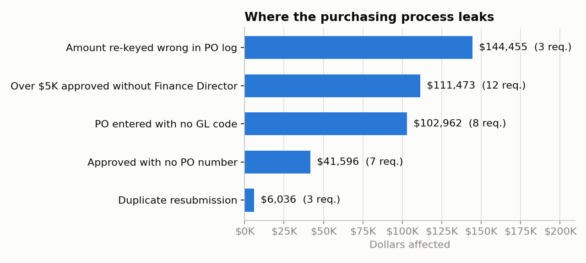
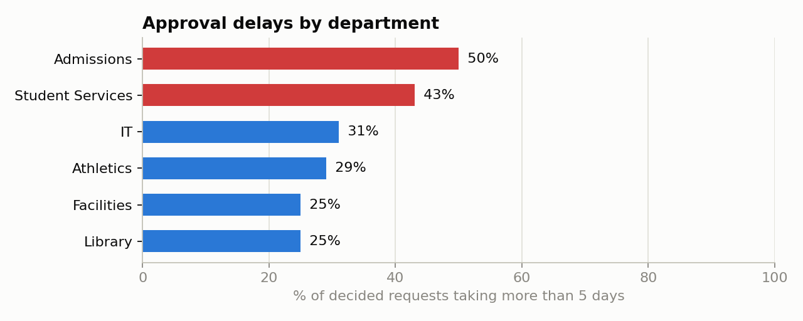

# 1. Data findings

Source: `data/purchase_requests.csv` (63 requests, Jul–Sep 2026) and `data/finance_po_log.csv` (43 POs).
Queries: [`sql/01_issue_log.sql`](../sql/01_issue_log.sql), [`02_approval_cycle.sql`](../sql/02_approval_cycle.sql), [`03_rekey_mismatches.sql`](../sql/03_rekey_mismatches.sql).

| # | Issue | Requests | $ affected | Root cause | Evidence |
|---|---|---|---|---|---|
| 1 | Amount re-keyed wrong in PO log | 3 | $144,455 | Finance re-types amounts by hand | REQ-023 approved at $7,336, logged **and paid** at $73,363; REQ-057 $8,706 → $87,063 (unpaid, still catchable); REQ-033 $78.90 → $7.89 |
| 2 | Over $5K approved without Finance Director | 12 | $111,473 | Approval goes by email to the dept manager; nothing routes on amount | REQ-002 ($13.5K), REQ-037 ($13.6K), REQ-021 ($12.0K) … |
| 3 | PO entered with no GL code | 8 | $102,962 | GL code is optional in the PO log | Spend can't be charged to a budget line |
| 4 | Approved with no PO number | 7 | $41,596 | PO is issued manually after approval, sometimes never | Vendors ship and invoice with nothing to match against, which explains the vendor calls |
| 5 | Duplicate resubmission | 3 | $6,036 | Requesters can't see status | REQ-061 = REQ-012 and REQ-062 = REQ-042 (both **already approved**); REQ-063 resubmits rejected REQ-034 |

**Approval speed:** median 3 days, max 14. **17 of 53 decided requests (32%) took more than 5 days.** Admissions (50%) and Student Services (43%) are slowest.

**Most urgent action:** REQ-023 looks like a **~$66K overpayment** to the vendor. Finance should check the invoice and recover the money. Hold REQ-057 ($87K logged vs. $8.7K approved) before it's paid.
