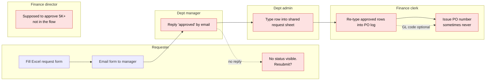

# 2. As-is process (current state)

| Pain point (red) | Finding it causes |
|---|---|
| Approval lives in email | No audit trail, no amount routing → **12 over-$5K approvals skipped the Director** |
| No status for the requester | **3 duplicate resubmissions**, 2 of them already approved |
| Two manual re-entries (admin sheet, PO log) | **3 amount errors**, one paid at 10x |
| PO issued by hand after approval | **7 approved requests with no PO** |
| GL code optional | **8 POs** can't be charged to a budget |
| No SLA or reminders | **32%** of decisions take more than 5 days |
