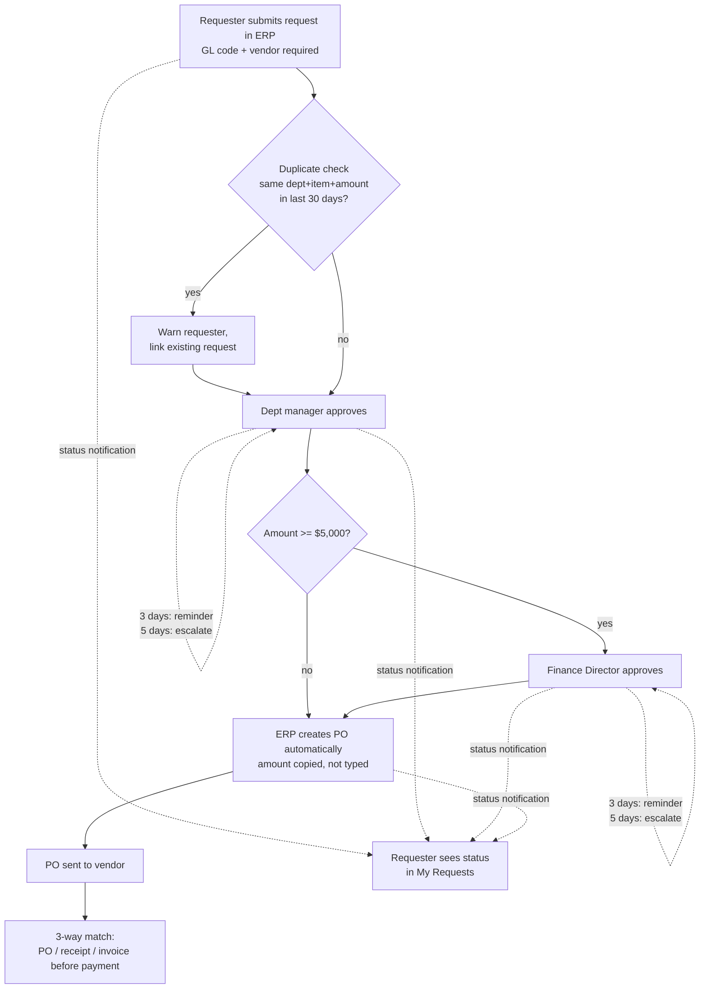

# 3. To-be process (ERP workflow)

## Routing and control rules
| Rule | Fixes finding |
|---|---|
| Amount-based routing: ≥ $5,000 → Finance Director after the manager | #2 policy bypass |
| PO auto-generated on final approval, amount carried over from the request | #1 re-keying, #4 missing PO |
| GL code mandatory at submission (dropdown from the chart of accounts) | #3 missing GL |
| Duplicate warning (dept + item + amount, 30 days) | #5 duplicates |
| Status notifications + "My Requests" view | #5 duplicates |
| SLA: reminder at 3 days, escalate to the next approver at 5 | approval delays |
| 3-way match before payment | stops an overpayment like REQ-023 |

## Out of scope (phase 2)
Vendor onboarding, catalog/punch-out ordering, budget-availability checks.
